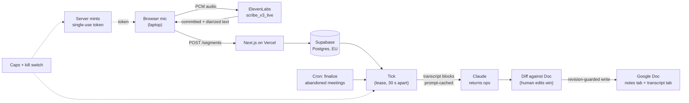

# Simon Says

**One laptop on the table. Live, structured meeting notes in a Google Doc.**

Simon Says listens to an in-person meeting through a single laptop microphone and writes
decisions, action items (with owner and due date) and "what we are discussing now" into a new
Google Doc while people talk. If someone types in the Doc, the service reads it and works around
it. It never overwrites what a human wrote.

Built for student and volunteer associations in Linköping. Free to use. The UI is in Swedish.
Production: https://simonsays.harrysson.co

**Status:** v1, in testing. The notes engine, the Google Doc writer and the end-to-end "Testmöte"
(a scripted fictional meeting) run on production. Live transcription with ElevenLabs is
verified on 2026-11-28. Not yet a finished product.


*A scripted, fictional board meeting filling the Doc. Screenshot of the result:
[docs/media/doc-filled.png](docs/media/doc-filled.png).*

## How it works



Audio goes from the laptop straight to ElevenLabs. Our server only sees committed text.

## Design principles

- **Human edits always win.** Before every write the service reads the Doc and compares whole
  paragraphs with what it last rendered. Anything a person touched is locked: kept verbatim,
  never reworded or removed. Text people type outside our ranges is sent to the model as
  read-only context, so it is not duplicated.
- **Revision-guarded writes.** Every Docs write carries the revision it was computed from. On a
  conflict the service re-reads, re-diffs and retries with a random backoff, so a person typing
  in the Doc is never clobbered.
- **Op-based notes, low churn.** Claude returns operations (add, change, remove an item), not a
  rewritten list. Items have stable ids, so the Doc changes little between ticks and does not
  flicker.
- **Server-counted usage caps.** Hours and dollars are counted from token mints and server time,
  never from client-reported numbers. Per-meeting, per-org and global daily caps, plus a kill
  switch.
- **Privacy by construction.** Supabase in the EU, Google scope `drive.file` only (the service
  can touch only files it created), no audio stored, consent confirmed in the room before Start,
  a pause button that stops audio immediately. Details: [/integritet](https://simonsays.harrysson.co/integritet).

## Measured

Only numbers we measured. The notes eval replays 7 fictional meetings (about 55 minutes in
total, Swedish and English, with traps such as a changed decision, a changed owner and a hedged
"no promises") through the real engine, 2 runs each.

| What | Result |
| --- | --- |
| Expected decisions and actions found | 96 of 96 |
| Forbidden items in the final notes (tabled, reversed or hedged things written as decisions or actions) | 0 |
| Notes churn (share of items that change between ticks), median | 8.7 % |
| Claude cost per meeting-hour | about $0.69 (cold cache about $0.75) |
| Testmöte, 10-minute scripted meeting replayed at 4x, start to finished Doc | about 3.5 minutes |
| Revision guard, 2 minutes of continuous typing in the Doc | 11 of 12 writes landed, the typed text stayed intact |

Caveats: the eval transcripts are clean and fictional, and the sample is small. Real meetings
are messier. The cost figure covers Claude only, not transcription.

## Roadmap

- **v1.1, name round and voices:** each person says their name once and the service remembers
  their voice, so names appear without a round from the second meeting on.
- **v1.1, learn the minutes format:** read a förening's old minutes in Google Docs and write the
  notes in the same shape.
- **Long-term, everything on a Jetson Orin Nano:** transcription, speaker separation and the
  notes model run locally on one small box, with jobs queued. A cloud turbo mode stays for when
  notes are needed instantly. See [docs/design.md](docs/design.md).

## Docs

[Design](docs/design.md) · [UI](docs/ui.md) · [Plan](docs/plan.md) · [Learnings](docs/learnings.md) ·
Stack: Next.js (App Router) on Vercel (`arn1`), Supabase (EU), ElevenLabs, Anthropic, Google Docs/Drive.

## Run locally

Needs Node 22+, and Docker for the local database.

```sh
npm ci
supabase start && supabase db reset   # local Postgres + auth
cp .env.example .env.local            # fill in, see below
npm run dev                           # http://localhost:3000
npm run typecheck && npm test
```

The "Testmöte" button on an org page replays a scripted fictional meeting through the real
pipeline into a Doc, with no microphone needed.

## Environment variables

Validated in `lib/env.ts` (zod) on first use. Never commit real values.

| Variable | Purpose |
| --- | --- |
| `SUPABASE_URL`, `SUPABASE_ANON_KEY`, `SUPABASE_SERVICE_ROLE_KEY` | Supabase project (the service role key is server only) |
| `GOOGLE_CLIENT_ID`, `GOOGLE_CLIENT_SECRET` | Google OAuth web client, also used by Supabase's Google provider |
| `TOKEN_ENC_KEY` | Encrypts Google refresh tokens: 32 random bytes, base64 (`openssl rand -base64 32`) |
| `ELEVENLABS_API_KEY` | Mints single-use realtime tokens |
| `ELEVENLABS_COMMIT_STRATEGY` | `manual`, `vad` or `turn_prediction` (default `vad`) |
| `ELEVENLABS_USD_PER_HOUR` | Cost booked per closed session (default `0.22`) |
| `ANTHROPIC_API_KEY` | Notes generation |
| `RESEND_API_KEY` | Alarm and summary email (optional) |
| `ALARM_EMAIL` | Where alarms go |
| `CRON_SECRET` | Authorises Vercel Cron requests |
| `APP_URL` | Public base URL (`http://localhost:3000` locally) |
| `GLOBAL_DAILY_HOURS`, `GLOBAL_DAILY_USD` | Global daily caps (defaults 30 h, $25) |
| `KILL_SWITCH` | `1` blocks token and tick endpoints |

## Migrations

Migrations live in `supabase/migrations` and reach `simonsays-prod` through Supabase's GitHub
integration on push to `main`. CI never runs `supabase db push`. Vercel deploys in parallel, so
**every migration must be backward compatible with the code in production**: add columns/tables
first and use them in a later deploy; never rename or drop in the same change as the code that
needs it. Automatic API grants are off, so every migration grants table access explicitly.

## CI

`.github/workflows/ci.yml`: gitleaks (full history), `supabase start` + `supabase db reset`,
`tsc --noEmit`, `vitest run`. `spike/` (Task 0 tooling) is excluded from typecheck and tests.

## License

No license file yet, so all rights are reserved by default.
